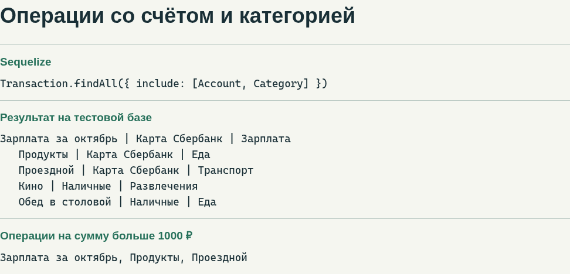

# Финансовые операции на Sequelize и SQLite

## Выборка расходов по счетам и категориям

Одна транзакция принадлежит счёту и категории. Скрипт queries.js выбирает расходы по типу, загружает названия связанных записей через include, добавляет поездку на такси и выбирает операции дороже 1000 ₽. На снимке показан результат для тестовых данных.



### Запуск примера

```sh
npm ci
npm run seed
npm run queries
```

Команда seed пересоздаёт таблицы в finance.sqlite. Каждый повторный запуск queries добавляет ещё одну тестовую операцию.
