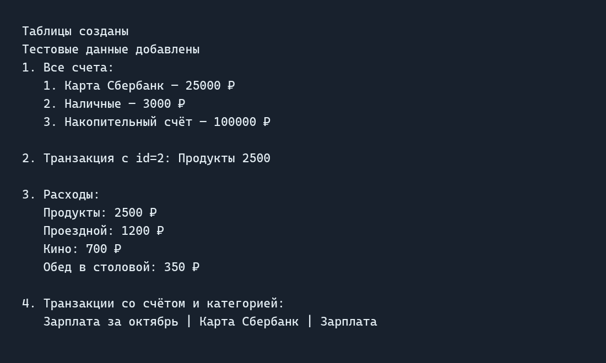

# kucherkakayatokt

## Запуск на тестовых данных

Учебный финансовый трекер на Node.js, Sequelize и SQLite связывает каждую операцию со счётом и категорией. В рабочей копии выполните команды ниже. Команда seed пересоздаёт таблицы в finance.sqlite.

```sh
npm ci
npm run seed
npm run queries
```

Сравните список всех счетов с выборкой расходов. В queries.js запрос с include добавляет к каждой операции её счёт и категорию.


